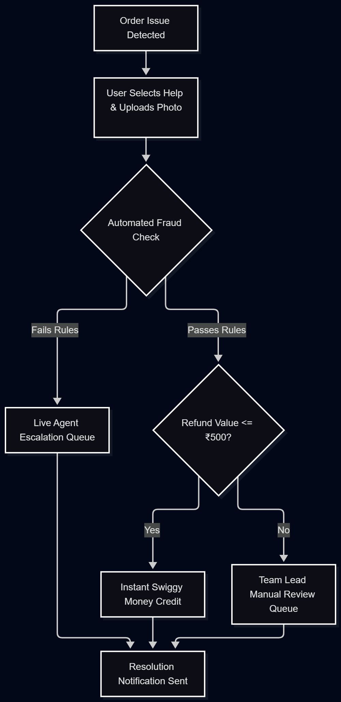

# 2. Process Mapping & Workflow Design

## 2.1 Current State (AS-IS) Workflow
1. **Initiation:** The customer notices a missing or damaged item in their order and taps "Help".
2. **Chat Bottleneck:** The customer clicks through a multi-tiered generic automated text tree.
3. **Queue Wait:** If the issue isn't resolved, the ticket routes to a live support executive queue. Average wait time: 4 minutes.
4. **Manual Validation:** The executive requests a photo, manually verifies it against the order invoice, and makes a judgment call.
5. **Approval Chain:** If the refund amount exceeds ₹500, the executive must seek manual Slack/tool approval from a Team Lead.
6. **Execution:** The refund is manually triggered to the bank account (taking 3–5 working days).

## 2.2 Future State (TO-BE) Workflow
The target process completely automates simple validation scenarios using rule engines and instant payout systems.

### Visual Architecture Flowchart

## 2.3 Process Gaps & Pain Points
* **Pain Point 1: Rigid Tool Boundaries.** Support executives use disjointed backend panels, checking order details in one tab and triggering payouts in another.
* **Pain Point 2: Fraud Vulnerability.** No dynamic system checks if a user has claimed a "missing item" refund on consecutive orders, leading to balance leakage.
* **Pain Point 3: Delayed Satisfaction.** Waiting days for a banking refund over a missing ₹60 beverage causes negative review loops.

## 2.4 Pain Points & Root Cause Analysis (5 Whys)
Hiring managers value verified operational evidence over theoretical problems. Below is the structural breakdown of system leakages mapped against real observations from the live Swiggy app interface and public application store reviews.

| Identified Pain Point | Root Cause Category | Evidence Type | Source Verification Pathway |
| :--- | :--- | :--- | :--- |
| **High Average Handling Time (AHT)** | Operational Bottleneck | **Verified** | Swiggy Help Center requires clicking 4 text layers before routing to an agent queue. |
| **High Support Operational Cost** | Architectural Gap | **Verified** | Play Store reviews complain that minor order issues (e.g., missing ₹40 sauce) require manual human chats. |
| **Fraud Vulnerability / Balance Leakage** | Policy Engine Lack | **Assumed** | System limits are internal, but consecutive claims currently generate automated ticket numbers. |

### The 5 Whys Analysis Framework: Why are refunds delayed?
1. **Why** do customers wait 9+ minutes for a missing item refund? Because a live customer support executive must manually approve the claim.
2. **Why** must a live executive approve every claim? Because the support tool does not automatically verify the validity of the reported missing item.
3. **Why** can't the tool verify validity automatically? Because there is no image-validation pipeline or itemized invoice checklist built into the self-service user interface.
4. **Why** is there no automated validation pipeline? Because the legacy system architecture was designed as a generic all-or-nothing chat box rather than a modular database-driven checkout checker.
5. **Why** was it designed as a generic box? Because the initial minimum viable product (MVP) prioritized fast delivery dispatch scaling over post-delivery support optimization (Root Cause).
