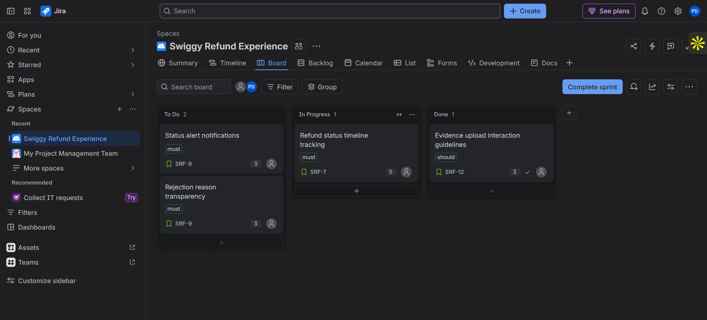
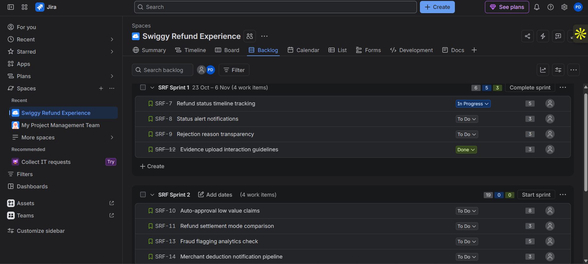
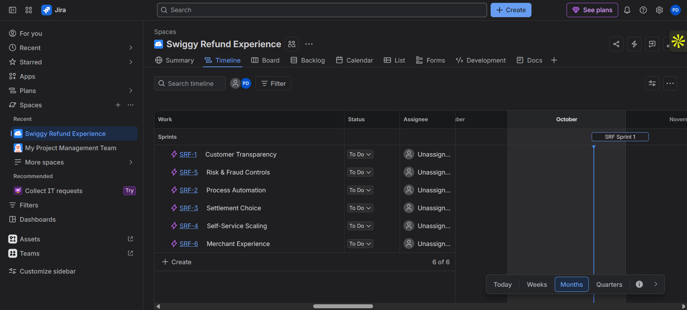

# 7. Jira Scrum Board & Agile Tracking Approach

## 7.1 Lifecycle Project Configuration
* **Project Name:** Swiggy Refund Experience (SRF)
* **Delivery Framework:** Agile Scrum Template
* **Core Workflow Track:** To Do ➔ In Progress ➔ In Review ➔ QA Testing ➔ Done
* **Issue Hierarchy Schema:** Epic ➔ User Story ➔ Technical Task ➔ Defect Bug

## 7.2 Delivery Epic Architecture
Epics serve as structural thematic buckets grouping development deliverables.

| Epic Reference Key | Epic Title Name | Functional Scope Domain |
| :--- | :--- | :--- |
| **SRF-1** | Customer Transparency | Status visibility, timeline interfaces, and tracking engines. |
| **SRF-2** | Process Automation | Auto-approval engines and configuration managers. |
| **SRF-3** | Settlement Choice | Multi-channel payment distribution matrices. |
| **SRF-4** | Self-Service Scaling | File attachment interface helpers and grid validations. |
| **SRF-5** | Risk & Fraud Controls | Account velocity checks and manual analyst queue routing. |
| **SRF-6** | Merchant Experience | Restaurant partner dashboard reporting modules. |

## 7.3 Sprint Execution Roadmap
* **Sprint 1 Focus (Foundational MVP Lifecycle):** Targets core transparency and foundational modules. Contains: `US-01, US-02, US-03, US-06` (**14 Story Points Total**).
* **Sprint 2 Focus (Automation Optimization):** Targets rules engines and advanced tracking features. Contains: `US-04, US-05, US-07, US-08` (**19 Story Points Total**).

## 7.4 Conceptual Delivery Visualizations
*(Note: Visual assets are linked directly to your active repository assets path below).*
* 
* 
* 

## 7.5 Project Performance Analytics & Tracking Mechanics
* **Bi-Directional Requirements Traceability:** Every issue card logs explicit Functional Requirement (FR) numbers in its header description to guarantee structural visibility.
* **Sprint Planning Guardrails:** Sprint limits are strictly bound using standard labels (`must`, `should`, `could`). 
* **Velocity Metrics Monitoring:** The development team evaluates burndown velocities at the end of each iteration cycle to optimize scoping rules for subsequent development waves.
